  <!-- Header Banner -->
  

  <!-- Animated Typing Headline -->
  

  

    <b>AI/ML Engineer</b> &nbsp;&bull;&nbsp; <b>Systems Developer</b> &nbsp;&bull;&nbsp; <b>Research Enthusiast</b>
  

  <!-- Interactive Quick Links -->
  

    
    &nbsp;
    
    &nbsp;
    
  

  

    
  

---

## About Me

Hi, I’m **Sravya**! I am a Computer Science and Engineering student with a genuine curiosity for how software behaves under the hood. My main interests revolve around applied machine learning, high-performance systems programming, and open-source development.

I particularly enjoy projects where machine learning models meet real systems engineering. Rather than treating AI as a black box, I like exploring what happens under strict constraints—whether that means extracting subtle blood volume pulse waveforms from facial video to detect deepfakes without identity leakage, or writing concurrent Rust pipelines that process millions of records using zero external crates.

When I step away from the keyboard, you will usually find me playing a casual match of chess, listening to romantic lo-fi beats, or exploring open-source repositories.

  

---

## Live Interactive Suite: Playable Chess & Lo-Fi Lounge

Since GitHub README files cannot run custom JavaScript, I built a companion static web portfolio featuring live interactive tools:

  

 

- ♟️ **Playable Chess Game**: Built with a complete chess engine in clean vanilla JavaScript. Supports legal move validation, castling, en passant, pawn promotion, check/checkmate detection, move undo, and a lightweight Minimax AI opponent if you want to play a quick match.
- 🎵 **Romantic Lo-Fi Music Player**: An ambient, non-intrusive music space with spinning vinyl animations, live audio waveforms, seekable progress scrubbing, volume controls, and a strict no-autoplay policy.

👉 **[Launch the Interactive Portfolio & Play Live &rarr;](https://sravyamummana2006.github.io/SravyaMummana2006/)**

  

---

## Projects I've Built

Every project below represents software I designed, benchmarked, and implemented:

### 🔬 [BIOTrace: Multimodal Media Authenticity](https://github.com/SravyaMummana2006/BioTrace)
`[FLAGSHIP RESEARCH]` `[PROTOCOL C ISOLATED]` `[344 TESTS PASSING]`

* **The Problem**: Common deepfake detectors look for spatial surface artifacts in facial images, which easily breaks under video compression, noise, or modern diffusion generators.
* **Why I Built It**: I wanted to explore whether measuring real human biological signals—specifically subcutaneous blood volume pulses and involuntary eye mechanics—could provide an evasion-resistant way to verify video authenticity.
* **How It Works Technically**: Evaluated strictly on the HiDF benchmark with zero identity overlap between training and testing sets (Protocol C bipartite actor isolation). It pairs convolutional visual representations (EfficientNet-B0) with remote photoplethysmography (rPPG via CHROM & POS algorithms) and Eye Aspect Ratio (EAR) kinematics. The architecture couples a desktop Java 21 Swing forensic workstation (FlatLaf theme with live JFreeChart pulse telemetry) with a high-throughput Python FastAPI inference backend, validated with 344 automated tests.
* **Technologies Used**: `Java 21 LTS`, `Python 3.11`, `PyTorch 2.6`, `FastAPI`, `OpenCV`, `MediaPipe`, `SQLite JDBC`, `FlatLaf`, `Maven`.
* **What Makes It Interesting**: Achieved **0.7952 ROC-AUC** and **0.7799 PR-AUC** under strict identity isolation, proving that biological signals remain viable forensic indicators even when visual appearances change.

---

### ⚡ [SPEED_DEMON: High-Throughput Log Ingestion Engine](https://github.com/SravyaMummana2006/SPEED_DEMON)
`[SYSTEMS PROGRAMMING]` `[ZERO-CRATE RUST]` `[PARALLEL LOG ENGINE]`

* **The Problem**: Log parsers and analytics pipelines often introduce significant memory bloat, thread lock contention, and high heap allocation overhead when ingesting gigabytes of server telemetry.
* **Why I Built It**: I wanted to challenge myself to write an ultra-fast, zero-dependency parallel ingestion engine in pure Rust using only the standard library.
* **How It Works Technically**: Implements multithreaded chunk newline alignment using `std::thread::scope` for scoped concurrency without runtime overhead. Each thread reuses a 1 MiB streaming buffer, strings are interned with custom byte-slice dictionary indexing, and group aggregations are packed into 64-bit composite integer keys (`(hour_key << 32) | endpoint_id`). Zero external crates, zero `unsafe` blocks.
* **Technologies Used**: `Rust 1.80+`, `std::thread::scope`, `Streaming I/O`, `Bitwise Packing`, `Cargo LTO`.
* **What Makes It Interesting**: Parsed and aggregated **3.1 million log records (238 MB)** on an Intel Core i5-13420H (12 logical cores) in **~437 ms** (a 1.81x speedup over the single-threaded baseline) while keeping peak memory strictly below 270 MB.

---

### 🛡️ [DOGFOOD 2026: Verifiable Hackathon Judging Platform](https://github.com/SravyaMummana2006/dogfood)
`[CRYPTOGRAPHIC INTEGRITY]` `[ED25519 SIGNATURES]` `[ARGON2ID]`

* **The Problem**: Hackathon and competition evaluation often suffers from uncalibrated scoring criteria, judge bias, and unverified winner announcements.
* **Why I Built It**: To build a self-hosted competition platform that ensures fair rubric evaluation and provides cryptographic proof for every scoring decision.
* **How It Works Technically**: Features salted Argon2id password hashing, high-entropy session management, server-side Min-Max rubric score normalization across independent criteria to eliminate judge bias, and immutable PostgreSQL audit logs. Top submissions receive winner certificates digitally signed with native Ed25519 keypairs.
* **Technologies Used**: `TypeScript`, `Node.js`, `PostgreSQL`, `Argon2id`, `Ed25519 Cryptography`, `Docker Compose`.
* **What Makes It Interesting**: Server-side normalization mathematically removes judge leniency bias, and the Ed25519 digital signatures allow winner certificates to be verified independently without trusting a third party.

---

### 🛰️ [AI Land Use & Deforestation Analysis](https://github.com/SravyaMummana2006/AI-LAND-USE-AND-DEFORESTRATION-ANALYSIS)
`[GEOSPATIAL REMOTE SENSING]` `[TEMPORAL CNN]` `[GEMINI REASONING]`

* **The Problem**: Illegal logging and rapid land degradation often go unaddressed due to manual satellite inspection delays and lack of automated ecological impact scoring.
* **Why I Built It**: To automate ecological monitoring by comparing temporal satellite image pairs and translating visual changes into understandable environmental impact summaries.
* **How It Works Technically**: Analyzes temporal satellite pairs using deep convolutional networks (CNN) and OpenCV structural change detection. Performs 5-class land segmentation (Forest, Water, Urban, Agriculture, Barren), calculates an Environmental Impact Score (EIS), and connects with the Google Gemini API for structured ecological risk assessments.
* **Technologies Used**: `Python`, `TensorFlow / Keras`, `OpenCV`, `Google Gemini API`, `Streamlit`.
* **What Makes It Interesting**: Bridges pixel-level surface canopy reduction metrics with multimodal AI reasoning to draft practical environmental risk summaries.

---

### 👁️ [AI Eye Health & Fatigue Monitor](https://github.com/SravyaMummana2006/AI-EYE-MONITOR)
`[EDGE COMPUTER VISION]` `[OCULAR KINEMATICS]` `[GLASSES-OPTIMIZED]`

* **The Problem**: Many webcam blink detectors constantly misfire for people who wear prescription glasses because of specular reflections, glare, and frame shadows.
* **Why I Built It**: As someone who spends hours in front of screens, I wanted an eye fatigue and blink monitor that actually works reliably for glasses wearers in normal indoor lighting.
* **How It Works Technically**: Tracks 468 facial mesh landmarks in real time via MediaPipe Face Mesh. Computes dual-eye Eye Aspect Ratio (EAR) combined with an adaptive baseline threshold calibration algorithm and temporal moving-average smoothing. Monitors blink velocity, frequency per minute, prolonged closure alerts, and ergonomic screen distance.
* **Technologies Used**: `Python`, `MediaPipe Face Mesh`, `OpenCV`, `NumPy`.
* **What Makes It Interesting**: The dynamic glasses-friendly baseline calibration adapts to specular reflections, eliminating false positive blink misclassifications.

---

### ✋ [AirCanvas: Touchless Gesture Canvas](https://github.com/SravyaMummana2006/AirWriting)
`[HUMAN-COMPUTER INTERACTION]` `[GESTURE STATE MACHINE]` `[OPENCV]`

* **The Problem**: Digital whiteboards and interactive drawing usually require stylus hardware, touchscreens, or specialized hardware.
* **Why I Built It**: To turn an ordinary laptop webcam into a touchless whiteboard where you can sketch in mid-air using natural hand gestures.
* **How It Works Technically**: Tracks 21 3D hand landmarks using MediaPipe Hands, isolating index fingertip coordinates. An intuitive gesture state machine handles transitions (pinch thumb and index to draw, open palm to pause or pick palette colors). Renders continuous Bezier-smoothed strokes on a transparent OpenCV canvas overlay.
* **Technologies Used**: `Python`, `MediaPipe Hands`, `OpenCV`, `NumPy`.
* **What Makes It Interesting**: Runs smoothly with zero perceptible lag on an ordinary laptop camera with no external sensors or markers required.

---

### 📈 [Intelligent Investment Decision Engine](https://github.com/SravyaMummana2006/invest-engine)
`[FINANCIAL MODELING]` `[FISHER INFLATION LOGIC]` `[SCENARIO TELEMETRY]`

* **The Problem**: Most retail investment calculators project simple nominal compounding curves that completely ignore how inflation eats away real purchasing power over time.
* **Why I Built It**: To provide personal investors with realistic macroeconomic portfolio telemetry that calculates true post-inflation real capital longevity.
* **How It Works Technically**: Applies the Fisher equation to model real vs. nominal returns. Simulates SIP contributions, multi-asset risk allocation (equities, debt, gold), and stress-tests conservative, realistic, and aggressive market trajectories with interactive Plotly telemetry and structured CSV exports.
* **Technologies Used**: `Python`, `Streamlit`, `Plotly`, `Pandas`, `Financial Modeling`.
* **What Makes It Interesting**: Focuses on real purchasing-power erosion and scenario-based drawdown stress testing instead of oversimplified linear growth projections.

  

---

## Technical Skills & Toolkit

Technologies I actively use in my projects, research pipelines, and systems code:

<table>
  <tr>
    <td width="28%" valign="top"><b>Languages</b></td>
    <td width="72%">
      
      
      
      
      
      
      
    </td>
  </tr>
  <tr>
    <td valign="top"><b>AI, ML &amp; Vision</b></td>
    <td>
      
      
      
      
      
      
      
      
    </td>
  </tr>
  <tr>
    <td valign="top"><b>Backend &amp; Systems</b></td>
    <td>
      
      
      
      
      
      
      
    </td>
  </tr>
  <tr>
    <td valign="top"><b>Tools &amp; Infrastructure</b></td>
    <td>
      
      
      
      
      
      
    </td>
  </tr>
</table>

  

---

## Open Source Contributions

I believe in contributing to the tools and communities that empower modern engineering:
* **[DIPY (Diffusion Imaging in Python)](https://github.com/dipy/dipy)**: Engaged in 3D/4D medical imaging algorithms and scientific Python workflows.
* **[OWASP / OpenCRE](https://github.com/OWASP/OpenCRE)**: Contributing to security standard mappings, requirements engineering, and verification schemas.
* **[OWASP Nettacker](https://github.com/OWASP/Nettacker)**: Community vulnerability scanner investigations and penetration testing tools.

  

---

## GitHub Activity & Telemetry

  <!-- Repository Benchmarks & Language Distribution -->
  

    

  <!-- Contribution Streak Telemetry -->
  

    

  <!-- Animated Contribution Snake Console -->
  

  

---

## Get in Touch

I am always open to technical discussions, research collaborations, or engineering opportunities:

  
  &nbsp;
  
  &nbsp;
  

 

  Deep Charcoal &amp; Emerald Palette &bull; &copy; Sravya Mummana

